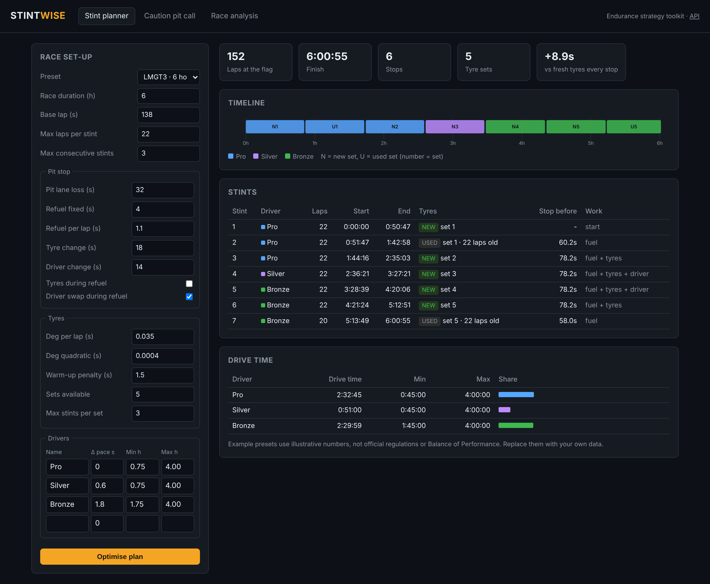
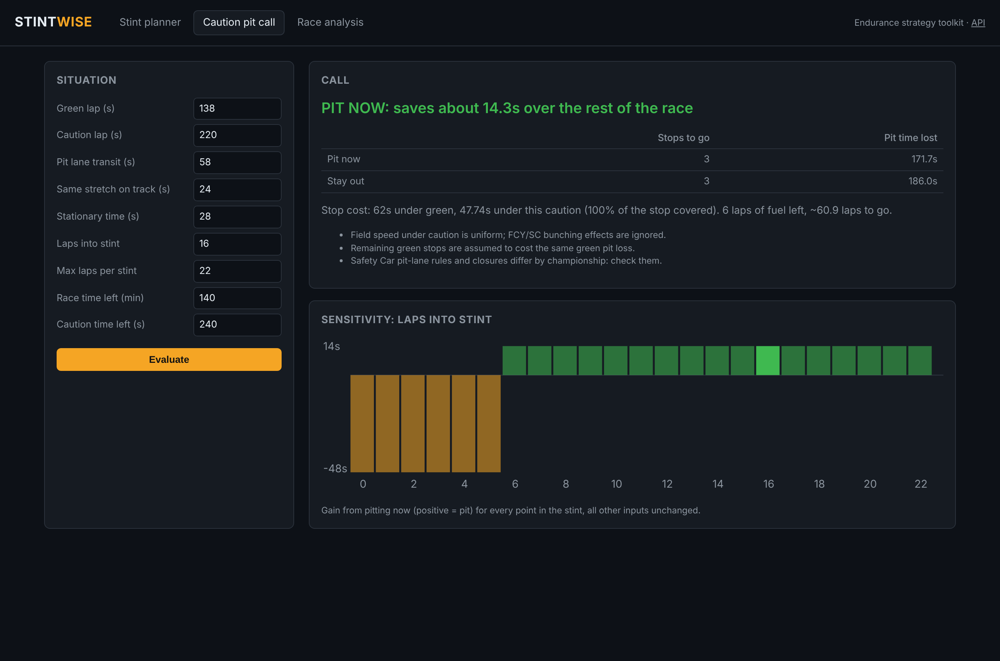

# Stintwise

**Endurance race strategy toolkit for WEC-style racing:** stint and driver planning,
pit calls under Full Course Yellow / Safety Car, and strategy analysis of real
races from official lap timing.

[](https://github.com/ar-karkon/F1/actions/workflows/ci.yml)
[](LICENSE)



## What it does

### 1. Stint planner
Takes a timed race (4h, 6h, 24h…) and returns the fastest plan:

- **Stint lengths** from the fuel or energy allocation, with a short final stint to the flag
- **Tyres**: at which stops to fit a new set (double/triple stinting) within the tyre allocation
- **Drivers**: who drives each stint, respecting **minimum and maximum drive time**
  (e.g. Bronze minimum in LMGT3) and a maximum number of consecutive stints
- **Pit stops**: pit lane loss + refuelling + tyres + driver change, in sequence
  or in parallel depending on the rules you configure

Tyre and driver decisions are solved **exactly** with dynamic programming, and
the tests check both solvers against brute-force enumeration.

### 2. Caution pit call
*"FCY just came out and we are 16 laps into a 22-lap stint: pit now or stay out?"*
Compares the cheaper stop under caution with the risk of adding a stop before
the flag, and shows the answer for every point in the stint.



### 3. Race analysis from real timing
Reads the **Al Kamel lap Analysis CSV** published for FIA WEC, ELMS, Asian Le Mans
and IMSA and rebuilds every car's race:

- stints, drivers, clean pace and tyre degradation per stint
- every pit stop, driver change and pit-lane time
- FCY / Safety Car periods
- **how much each stop cost relative to the field**, under green vs FCY vs SC


*Screenshots use the built-in synthetic demo race (invented teams and data).*

## Quick start

```bash
git clone https://github.com/ar-karkon/F1.git stintwise && cd stintwise
python -m venv .venv && source .venv/bin/activate
pip install -e ".[dev]"

stintwise serve            # dashboard on http://127.0.0.1:8000, API docs at /docs
```

Command line:

```bash
stintwise plan --preset example-lmgt3-6h
stintwise plan --preset example-hypercar-24h --json
stintwise plan --spec my_team.json

stintwise caution --green-lap 138 --caution-lap 220 --pit-transit 58 \
  --track-equivalent 24 --stationary 28 --laps-into-stint 16 \
  --max-stint-laps 22 --race-left 8400 --caution-left 240

stintwise analyze data/races/wec-2025-spa-race.csv --class LMGT3
stintwise analyze data/races/wec-2025-spa-race.csv --car 92
```

Docker: `docker build -t stintwise . && docker run -p 8000:8000 -v $PWD/data/races:/data stintwise`

Real timing files: see [docs/DATA.md](docs/DATA.md). They are not committed to
the repository.

## Using your own numbers

Presets are **illustrative examples**, not official regulations or Balance of
Performance. A plan spec is plain JSON:

```json
{
  "duration_s": 21600, "base_lap_s": 138.0, "max_stint_laps": 22,
  "max_consecutive_stints": 3,
  "drivers": [
    {"name": "Pro",    "pace_offset_s": 0.0, "max_drive_s": 14400},
    {"name": "Silver", "pace_offset_s": 0.6, "min_drive_s": 2700},
    {"name": "Bronze", "pace_offset_s": 1.8, "min_drive_s": 6300}
  ],
  "pit":   {"lane_loss_s": 32, "refuel_base_s": 4, "refuel_per_lap_s": 1.1,
            "tyre_change_s": 18, "driver_change_s": 14,
            "tyres_parallel": false, "driver_change_parallel": true},
  "tyres": {"deg_s_per_lap": 0.035, "deg_quad_s": 0.0004, "warmup_s": 1.5,
            "sets_available": 5, "max_stints_per_set": 3}
}
```

## Project layout

| Module | |
|---|---|
| `stintwise/planner.py` | stint / tyre / driver optimiser |
| `stintwise/caution.py` | FCY / SC pit-call model |
| `stintwise/timing.py` | Al Kamel Analysis CSV parser |
| `stintwise/analysis.py` | stints, stops, cautions, pit loss vs field |
| `stintwise/api.py`, `static/` | FastAPI service and dashboard |

[Method and assumptions](docs/METHOD.md) · [Roadmap](docs/ROADMAP.md)

## Status

Working research tool, not an official team product. Every model input is
explicit, and the [known limitations](docs/METHOD.md#known-limitations) are
documented. Built to be checked against a team's own data.

MIT licensed.
