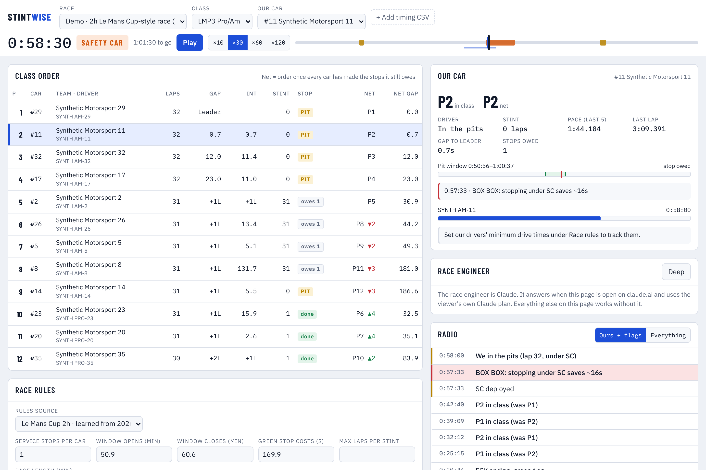

# Stintwise

**An AI pit wall for endurance racing teams.** Built first for the Michelin Le Mans Cup,
ELMS and Asian Le Mans Series (LMP3, LMP2, GT3), and works with any championship timed
by Al Kamel (WEC, IMSA).

[](https://github.com/ar-karkon/F1/actions/workflows/ci.yml)
[](LICENSE)



Small endurance teams run strategy from live timing, a spreadsheet and experience. The
calls that decide their races are the same every weekend: *box now under this Safety
Car or stay out? Is our Bronze driver going to make the minimum drive time? Who is
really ahead once everybody has stopped?* Stintwise answers them from official timing,
in a second, and explains the answer.

## Race day

- **Caution calls.** When an FCY or Safety Car comes out, Stintwise says whether to box,
  with the time it saves: "BOX BOX: stopping under SC saves ~82 s", "stay out: pit
  window not open", "stay out: a driver change now leaves our Bronze 10 min short".
- **Net order.** The class order once every car has made the stops it still owes, so the
  stop cycle stops hiding who is really ahead.
- **Drive-time watch.** Driven time per driver against minimum and maximum limits, and
  the latest moment the driver change can happen.
- **Radio feed.** Cautions, rival stops, pace drops and fuel-window warnings for our car.
- **Rules learned from earlier rounds.** Stops per car, the driver-change window and what
  a stop costs under green, FCY and Safety Car, inferred from previous races' timing.

## Claude as the race engineer, on your own Claude plan

1. **Pit wall on claude.ai.** The pit wall page runs as a claude.ai artifact. Ask the engineer
   by typing or by voice ("Should we box under this caution?", or in Persian), and it
   can read calls aloud. Claude runs on the viewer's own Claude account and calls the
   engine's functions for every number; it does not invent figures.
2. **Claude Desktop / Claude Code.** An MCP server exposes the same tools:
   ```bash
   pip install -e ".[mcp]"
   claude mcp add stintwise -- stintwise mcp          # Claude Code
   ```
   For Claude Desktop add `{"command": "stintwise", "args": ["mcp"]}` under
   `mcpServers` in `claude_desktop_config.json`. Then ask, for example: *"Debrief car 71
   in data/races/lmc-2026-r6-algarve.csv"*.

## Measured on real races

The [2026 Le Mans Cup case study](docs/CASE_STUDY_LMC_2026.md) runs Stintwise on all six
races of the season (268 entries, 11,908 laps):

| LMP3 Pro/Am service stop, cost against the field | Median |
|---|---:|
| Under green (78 stops) | 174.7 s |
| Under Safety Car (16 stops) | 105.7 s |

At Algarve an FCY came out 14–30 seconds after four LMP3 Pro/Am cars had made their stop
under green. Replayed on the pit wall, the car that stopped under that FCY (#34) gets
"BOX BOX" at 55:02 from rules learned on earlier rounds only.

## After the race

`stintwise debrief` ranks each driver's clean pace in the class, compares every stop with
the class median stop under the same flag, and lists cautions that came while the stop
was still owed: a one-page answer to "where did the time go?".

## Before the race

- **Stint planner:** stint lengths, double stints within the tyre allocation and driver
  order under minimum and maximum drive times, solved exactly (dynamic programming,
  checked against brute force).
- **Caution what-if:** pit now or stay out for any point in a stint.

## Quick start

```bash
git clone https://github.com/ar-karkon/F1.git stintwise && cd stintwise
python -m venv .venv && source .venv/bin/activate
pip install -e ".[dev]"

stintwise serve            # http://127.0.0.1:8000/pitwall/  (planner at /, API at /docs)
```

```bash
# Learn rules from earlier rounds, then replay a race as the pit wall saw it
stintwise fit data/races/lmc-2026-r{1,2,4,5}*.csv --class "LMP3 Pro/Am" > rules.json
stintwise events  data/races/lmc-2026-r6-algarve.csv --class "LMP3 Pro/Am" --car 34 --rules rules.json --only-focus
stintwise replay  data/races/lmc-2026-r6-algarve.csv --class "LMP3 Pro/Am" --car 34 --rules rules.json --at 55m
stintwise debrief data/races/lmc-2026-r6-algarve.csv --car 34
stintwise plan --preset lmc-lmp3-proam-2h
```

Timing files: [docs/DATA.md](docs/DATA.md). They stay on your machine and are never
committed.

## How it is built

| Part | |
|---|---|
| `stintwise/timing.py` | Al Kamel Analysis CSV parser (flags normalised, Safety Car = `SF`) |
| `stintwise/live.py` | race state at any race time, net order, drive time, caution calls, radio feed |
| `stintwise/debrief.py`, `fit.py` | post-race debrief; rules learned from earlier races |
| `stintwise/planner.py`, `caution.py` | stint/tyre/driver optimiser; caution what-if |
| `stintwise/mcp_server.py` | MCP tools for Claude Desktop and Claude Code |
| `stintwise/static/engine.js` | the same engine in JavaScript for the pit wall page |
| `stintwise/static/pitwall.html` | the pit wall (local server or claude.ai artifact) |

The live engine only uses timing that existed at the replayed race time, so a replay
shows exactly what the pit wall would have seen. The JavaScript engine is tested against
the Python engine on synthetic races and on real Le Mans Cup races
(`tests/test_js_parity.py`). [Method and limits](docs/METHOD.md) · [Roadmap](docs/ROADMAP.md)

MIT licensed. Not affiliated with any championship, team or timing provider.
