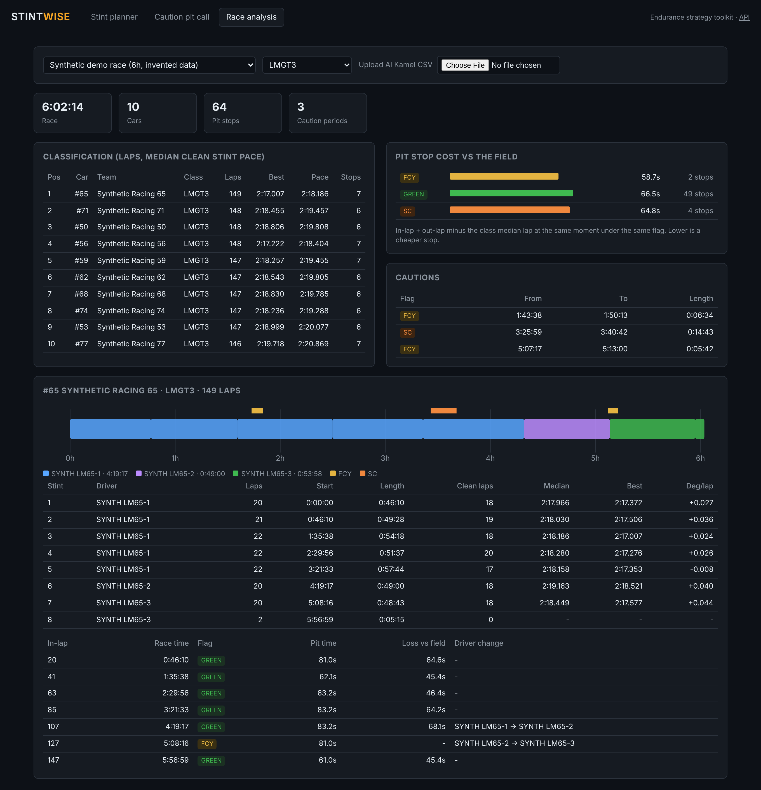
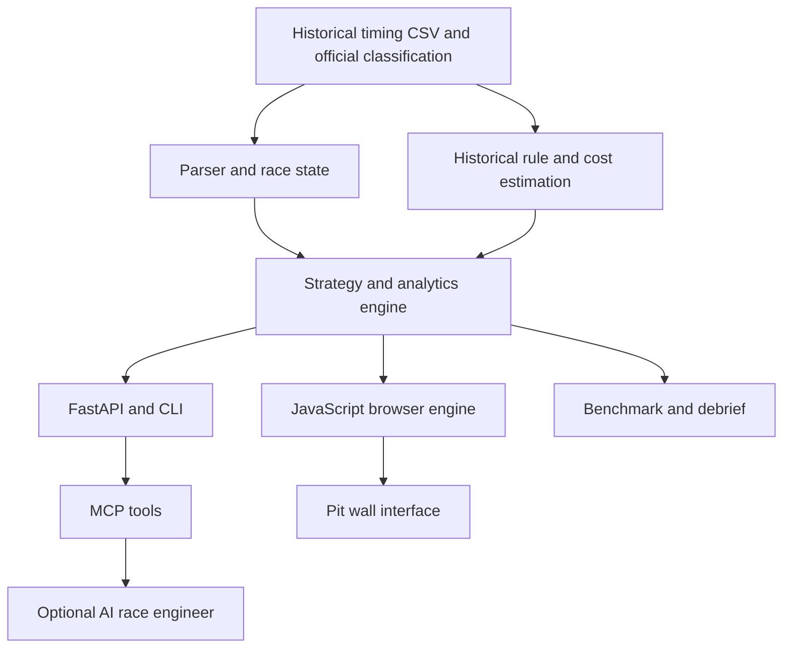

<!-- STINTWISE:HEADER:BEGIN -->
<div align="center">

# STINTWISE

### Strategy. Timing. Insight.

**An open-source AI pit wall for endurance racing teams.**

[](https://github.com/ar-karkon/F1/actions/workflows/ci.yml)
[](pyproject.toml)
[](LICENSE)
[](#ai-race-engineer)
[](#validation)

[Quick start](#quick-start) · [Pit wall](#the-race-weekend) · [Validation](#validation) · [Architecture](#architecture) · [Roadmap](#roadmap)


</div>
<!-- STINTWISE:HEADER:END -->

---

## Built for the decisions that define a race

Endurance racing is a continuous trade-off between pace, track position, fuel, tyres, driver time and uncertainty. Small teams often need to solve these problems with a timing screen, a spreadsheet and experience.

**Stintwise turns historical race timing into explainable strategy intelligence.** It brings pre-race planning, race replay, caution analysis and post-race debrief into one toolkit, with an optional tool-using AI race engineer.

The numerical engine operates independently of the language model. Every strategic call should be traceable to data, assumptions and uncertainty—not a chatbot's intuition.

> [!IMPORTANT]
> Stintwise is a research prototype. The pit wall currently replays historical timing files; a live championship feed and on-track team validation are not yet implemented. It is not approved for operational race decisions.

## The race weekend

| Before the race | During historical replay | After the race |
| :--- | :--- | :--- |
| Stint and tyre planning | FCY / Safety Car pit calls | Driver pace rankings |
| Driver allocation and drive-time constraints | Net class order and stops owed | Stop loss vs class peers |
| Pit-now vs stay-out scenarios | Drive-time and fuel-window warnings | Missed caution opportunities |
| Configurable race presets | Event timeline and radio-style alerts | Markdown race debrief |

<details>
<summary><b>Explore the actual product interfaces</b></summary>

### Stint planner


### Caution strategy


### Race analysis



</details>

## Validation

<div align="center">

| Historical races | Lap records | Car entries |
| :---: | :---: | :---: |
| **56** | **152,855** | **2,426** |

</div>

The repository reports a historical benchmark on Michelin Le Mans Cup (2022–2026) and European Le Mans Series (2023–2026). Rules and costs are intended to be learned from earlier races, with as-of race-state snapshots. These are reported research results, not an independently certified assessment.

| Metric | Reported result | Cases | Target |
| :--- | ---: | ---: | ---: |
| Class-order reconstruction, unpenalised pairs | 99.9% | 11,978 | ≥99% |
| Lap-count agreement | 99.2% | 2,108 | ≥99% |
| Driver-change window coverage | 96.0% | 926 | ≥95% |
| Stops per car (metric-specific tolerance) | 90.9% | 1,519 | ≥85% |
| Minimum drive-time inference | 100% | 31 | ≥90% |
| Green stop cost median absolute error | 5.0 s | 2,757 | ≤8 s |
| Caution probability calibration error | 0.034 | 93 | ≤0.10 |
| Caution range coverage | 83.9% | 93 | ≥75% |
| Caution gain median absolute error | 39.3 s | 93 | ≤30 s |
| Caution-call accuracy on clear cases | 72.9% | 85 | ≥85% |
| Net order after the stop cycle, mixed pairs | 77.0% | 1,219 | ≥80% |

Three reported targets remain unmet. The 99.9% result measures reconstruction, not race-outcome prediction. The caution model is evaluated on observed stops, not all counterfactual opportunities. Cross-series chronological ordering and prospective inputs require further validation before live use.

**[Full benchmark and reproduction instructions →](docs/ACCURACY.md)**

### Case study: Algarve, 2026

In a historical replay of the Michelin Le Mans Cup, the system identified a caution inside the driver-change window for car #34. The replay estimated a potential saving of approximately 86 seconds and an empirical gain frequency of 84% among similar stops.

This was a retrospective simulation, not a recommendation delivered to the team during the race. See the [full case study](docs/CASE_STUDY_LMC_2026.md).

## Quick start

Requires Python 3.10 or later.

```bash
git clone https://github.com/ar-karkon/F1.git stintwise
cd stintwise
python -m venv .venv
source .venv/bin/activate
python -m pip install -e ".[dev]"
stintwise serve
```

On Windows PowerShell, activate with `.venv\Scripts\Activate.ps1`.

| Interface | Local URL |
| :--- | :--- |
| Pit wall | http://127.0.0.1:8000/pitwall/ |
| Planner | http://127.0.0.1:8000/ |
| Interactive API docs | http://127.0.0.1:8000/docs |

The application includes clearly labelled synthetic demo races. No AI API key is required for the numerical engine.

### Real timing data

```bash
python scripts/fetch_alkamel.py lemanscup 2025 2026
stintwise fit data/races/lmc-2025-*.csv data/races/lmc-2026-r[1245]-*.csv --class "LMP3 Pro/Am" --length 2h > rules.json
stintwise replay data/races/lmc-2026-r6-autodromo-do-algarve.csv --class "LMP3 Pro/Am" --car 34 --rules rules.json --at 55m
stintwise debrief data/races/lmc-2026-r6-autodromo-do-algarve.csv --car 34
```

See [data format and acquisition](docs/DATA.md). Raw timing files stay local and are excluded from version control. Review the provider's terms before commercial use or redistribution.

## AI race engineer

Stintwise exposes ten MCP tools for Claude Desktop and Claude Code. The language model explains and queries the numerical engine; it does not replace it.

```bash
python -m pip install -e ".[mcp]"
claude mcp add stintwise -- stintwise mcp
```

For Claude Desktop, register the installed command in its MCP configuration:

```json
{
  "mcpServers": {
    "stintwise": {
      "command": "stintwise",
      "args": ["mcp"]
    }
  }
}
```

Example questions:

- “What is our net class position after the stop cycle?”
- “Can our current driver satisfy the minimum drive-time requirement?”
- “Compare our pit stops with the class median and explain where we lost time.”

The browser pit wall also includes optional Claude artifact integration and numerical evidence checks. Availability depends on the host environment. Numeric matching is not a guarantee of semantic correctness; the engineer remains responsible for decisions.

## Architecture



| Layer | Implementation |
| :--- | :--- |
| Data | Al Kamel Analysis CSV parser and official classification |
| Optimisation | Dynamic programming for tyre and driver subproblems |
| Caution intelligence | Empirical nearest-neighbour estimates with uncertainty ranges |
| Race state | Time-bounded crossings, stops owed, net order and alerts |
| Interfaces | FastAPI, CLI, browser JavaScript engine and MCP |
| Validation | Pytest, Ruff, Python/JavaScript parity tests and historical benchmark |

Read the [method and assumptions](docs/METHOD.md) for algorithmic details. The alternating planner does not guarantee global optimality across all strategy variables.

## Championship scope

| Series | Evidence |
| :--- | :--- |
| Michelin Le Mans Cup | Historical benchmark and case study |
| European Le Mans Series | Historical benchmark |
| Asian Le Mans Series | Target; validation pending |
| FIA WEC / IMSA | Target; championship-specific validation pending |

## Development

```bash
python -m pip install -e ".[dev]"
ruff check src tests
pytest -q
```

Node.js enables JavaScript parity tests. Real-race parity checks require the relevant local timing files.

```bash
python scripts/fetch_alkamel.py lemanscup 2022 2023 2024 2025 2026
python scripts/fetch_alkamel.py elms 2023 2024 2025 2026
stintwise benchmark data/races
```

<details>
<summary><b>Repository structure</b></summary>

```text
src/stintwise/
  timing.py          Timing ingestion
  live.py            Race state and event engine
  planner.py         Stint, tyre and driver optimisation
  caution_model.py   Empirical caution prediction
  costs.py           Relative stop costs
  fit.py             Historical rule learning
  evaluate.py        Accuracy benchmark
  debrief.py         Post-race reports
  api.py             HTTP interface
  mcp_server.py      AI tool interface
  static/            Browser engine and dashboards
tests/               Regression and parity tests
scripts/             Data acquisition
docs/                Methods, evidence and roadmap
```

</details>

## Roadmap

- [x] Historical pit wall, planner and debrief
- [x] Historical Le Mans Cup and ELMS evaluation
- [x] Optional AI engineer via MCP and browser integration
- [ ] Strict cross-series temporal validation and stronger baselines
- [ ] Versioned sporting-regulation engine
- [ ] Authorised live timing ingestion
- [ ] Opponent stop prediction and stochastic strategy simulation
- [ ] Shadow-mode pilot with an endurance racing team

See [project roadmap](docs/ROADMAP.md).

## Contributing

Contributions are welcome, especially reproducible strategy research, robust timing ingestion, validation, test fixtures and championship-specific rules. Open an [issue](../../issues) with the scenario, expected behaviour, evidence and a reproducible example. Never commit confidential team data, API keys or restricted timing records.

## License

[MIT](LICENSE) for repository code. Championship timing data and third-party materials retain their own rights. Stintwise is an independent project and is not affiliated with a championship, team or timing provider.

<!-- STINTWISE:FOOTER:BEGIN -->
<div align="center">

**STINTWISE · Strategy. Timing. Insight.**

Built for the decisions that define endurance racing.

</div>
<!-- STINTWISE:FOOTER:END -->
